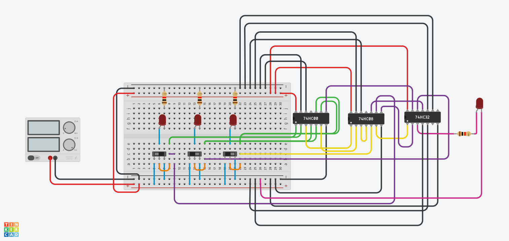

# Headlight Warning System: a three-input logic circuit in Tinkercad

This circuit watches three on/off signals from a car: whether the headlights are on, whether it is day or night, and whether the engine is running. It lights a red warning LED when the headlights are being used wrongly. It is built entirely from standard 74HC logic chips and simulated in Tinkercad Circuits.

The real work in this project is turning three plain-English rules into one Boolean expression (Boolean algebra is the maths of TRUE/FALSE values), minimising it, and building it from the gate chips Tinkercad provides. Real cars do the same job with a microcontroller in the body control module, which handles things like the "lights left on" reminder. Underneath, the decision is the same AND/OR logic shown here.

🔗 **Tinkercad:** [open the circuit](https://www.tinkercad.com/things/iWVmF328Zj1-fantabulous-kup)

## How it works

### Inputs and output

| Switch | Signal | 1 means | 0 means | Indicator LED |
|---|---|---|---|---|
| S1 | A – Headlights | ON | OFF | D1 |
| S2 | B – Time of day | Day | Night | D2 |
| S3 | C – Engine | Running | Off | D3 |
| — | W – Warning | Warning | No warning | D4 |

### The rules

The warning should come on in three situations:

| Situation | Term |
|---|---|
| Headlights off, at night, while driving | A'B'C |
| Headlights on during the day | AB |
| Headlights on with the engine off (drains the battery) | AC' |

A' means "NOT A". OR-ing the three terms together gives a sum-of-products expression, which means an OR of several AND terms:

$$W = A'B'C + AB + AC'$$

### Truth table

| A | B | C | W | Reason |
|---|---|---|---|---|
| 0 | 0 | 0 | 0 | |
| 0 | 0 | 1 | **1** | Driving at night with no lights |
| 0 | 1 | 0 | 0 | |
| 0 | 1 | 1 | 0 | |
| 1 | 0 | 0 | **1** | Lights left on, engine off |
| 1 | 0 | 1 | 0 | Correct use |
| 1 | 1 | 0 | **1** | Lights on in the day, engine off |
| 1 | 1 | 1 | **1** | Lights on in the day |

The warning cases are minterms 1, 4, 6 and 7 (a minterm is one row of the truth table, numbered by reading ABC as a binary number). On a Karnaugh map, 4 and 6 group into AC', 6 and 7 group into AB, and 1 has no neighbours, so it stays as A'B'C. The expression above is therefore already minimal.

### Gate implementation

The circuit factors the last two terms as A(B + C'). This is equivalent to AB + AC' and takes one fewer gate:

$$W = A'B'C + A(B + C')$$

| Chip | Type | Gates used | What it produces |
|---|---|---|---|
| U1 | 74HC00 quad NAND | 3 of 4 | A', B', C' |
| U2 | 74HC08 quad AND | 3 of 4 | A'B', A'B'C, A(B + C') |
| U3 | 74HC32 quad OR | 2 of 4 | B + C', W |

**NAND as NOT.** I couldn't find a NOT-gate chip in Tinkercad's parts library, so each inverter is a NAND gate with both inputs tied together. NAND(X, X) = NOT(X·X) = NOT X. This works because NAND is a universal gate: any logic function can be built from NAND alone.

**Switches as inputs.** Each switch is a single-pole double-throw (SPDT) switch. Its middle pin connects to either +5 V or ground, so every input is always a definite HIGH or LOW and needs no pull-up or pull-down resistor.

## Design files

| File | What it is |
|---|---|
| [circuit.png](circuit.png) | Breadboard view from Tinkercad |
| [Schematic.pdf](Schematic.pdf) | Schematic exported from Tinkercad |
| [BRD.brd](BRD.brd) | Board file exported from Tinkercad, in Eagle format |

## Parts

| Ref | Part | Value / setting |
|---|---|---|
| P1 | DC power source | 5 V |
| U1 | 74HC00 quad 2-input NAND | — |
| U2 | 74HC08 quad 2-input AND | — |
| U3 | 74HC32 quad 2-input OR | — |
| S1–S3 | Slide switch (SPDT) | — |
| D1–D4 | Red LED | — |
| R1–R4 | Resistor | 1 kΩ |

In a real car, A would come from the headlight switch, B from a light sensor and C from the ignition line, and a microcontroller would run the same logic.

## Wiring

All three chips use the standard 14-pin quad-gate pinout. Pin 14 goes to +5 V and pin 7 goes to ground.

**U1 – 74HC00 (inverters)**

| Pins | Connection |
|---|---|
| 1, 2 | A (S1) |
| 3 | A' → U2 pin 1 |
| 4, 5 | B (S2) |
| 6 | B' → U2 pin 2 |
| 9, 10 | C (S3) |
| 8 | C' → U3 pin 13 |

**U2 – 74HC08 (AND)**

| Pins | Connection |
|---|---|
| 1, 2 | A', B' |
| 3 | A'B' → U2 pin 4 |
| 4, 5 | A'B', C |
| 6 | A'B'C → U3 pin 1 |
| 9, 10 | A, B + C' (from U3 pin 11) |
| 8 | A(B + C') → U3 pin 2 |

**U3 – 74HC32 (OR)**

| Pins | Connection |
|---|---|
| 12, 13 | B, C' |
| 11 | B + C' → U2 pin 10 |
| 1, 2 | A'B'C, A(B + C') |
| 3 | W → R4 → D4 anode |

**LEDs:** each LED's anode connects to its signal, and its cathode goes to ground through a 1 kΩ resistor. D1–D3 sit on the A, B and C lines. D4 sits on W.

### Connections that must NOT be made

- ⚠️ D4's cathode to +5 V. The output can never rise above +5 V, so the LED is never forward-biased and never lights. This was the one bug in this build (see Known issues).
- ⚠️ Any LED without its 1 kΩ resistor.
- ⚠️ Two gate outputs connected together.

## Test procedure

1. Start the simulation. D1–D3 should show the switch positions.
2. Step through all eight combinations of S1–S3 in truth-table order.
3. For each combination, check that D4 matches the W column. **If D4 never lights in any combination, check its polarity first.**

## Results

All eight switch combinations were tested in Tinkercad, and D4 matched the truth table in every case.

**Logic depth.** The longest path from a switch to W passes through four gates: inverter → AND → AND → OR. With hand-operated switches, the resulting delay of a few tens of nanoseconds doesn't matter.

## Known issues and limitations

- **Output LED wired backwards (fixed).** At first, D4 never lit for any combination. The exported schematic showed the cause: D4's cathode was connected to P1+, while D1–D3 all returned to P1−. Moving the cathode to ground fixed it. 
- **Simulation only.** The circuit hasn't been built on a real breadboard.
- **Day/night is a manual switch.** A real system would need a light sensor with a threshold circuit.
- **Wasteful chip use.** Three chips are used for eight gates, and five gates sit idle.

## Things I learned

- The hard part is turning plain-English rules into truth-table rows. After that, the minimisation is mechanical.
- Factoring AB + AC' into A(B + C') saved a gate. The simplest-looking expression isn't always the cheapest circuit to build.
- An LED that never lights, whatever the inputs, usually means a wiring or polarity fault rather than a logic error. Comparing the exported schematic against the intended design is a quick way to find it.

## Future improvements

- Replace the day/night switch with an LDR (a light-dependent resistor) and a Schmitt-trigger threshold.
- Add a buzzer alongside D4.
- Tie all unused gate inputs to ground.
- Rebuild the whole function from 74HC00 NAND chips only, and compare the chip count.

## License

MIT. See [LICENSE](LICENSE).
